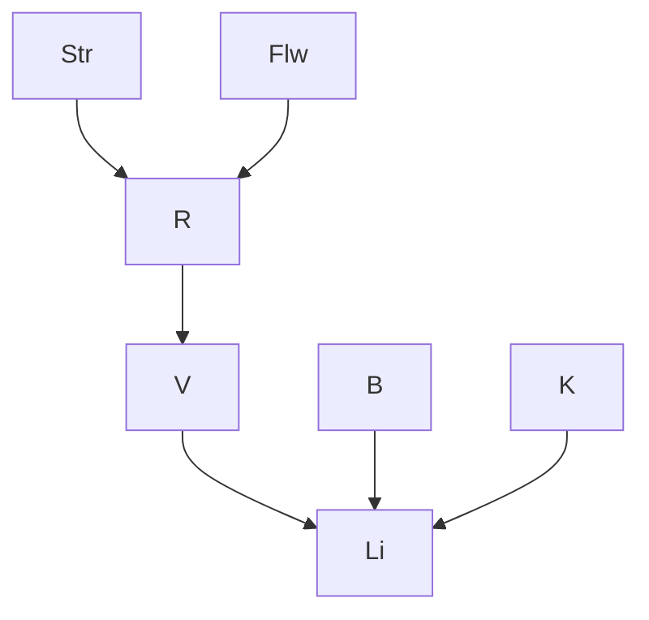

# Trabalho2IA_farol


Aluno(a): Samuel de Sousa Castro  
Matrícula: 22654091

## Estrutura da rede (item a)



Arestas: `Str→R, Flw→R, R→V, V→Li, B→Li, K→Li`.

Fatoração:

```
P(Str,Flw,R,V,B,K,Li) = P(Str) P(Flw) P(B) P(K) P(R|Str,Flw) P(V|R) P(Li|V,B,K)
```

## CPTs (itens b e c)

| Variável | Distribuição |
|---|---|
| P(Str) | dry 0,65 · wet 0,28 · snow_covered 0,07 |
| P(Flw=t) | 0,075 |
| P(B=t) | 0,95 |
| P(K=t) | 0,98 |
| P(R=t \| Str,Flw) | dry: 0,40 / 0,05 · wet: 0,70 / 0,20 · snow: 0,90 / 0,40 (Flw=t / Flw=f) |
| P(V=t \| R) | R=t: 0,10 · R=f: 0,95 |
| P(Li=t \| V,B,K) | tabela fornecida no enunciado |

## Como executar

```bash
python3 farol_bayes.py
```
## Resultado do item (e)

- P(V=t | Str=snow_covered) = 0,578125
- P(V=f | Str=snow_covered) = 0,421875


